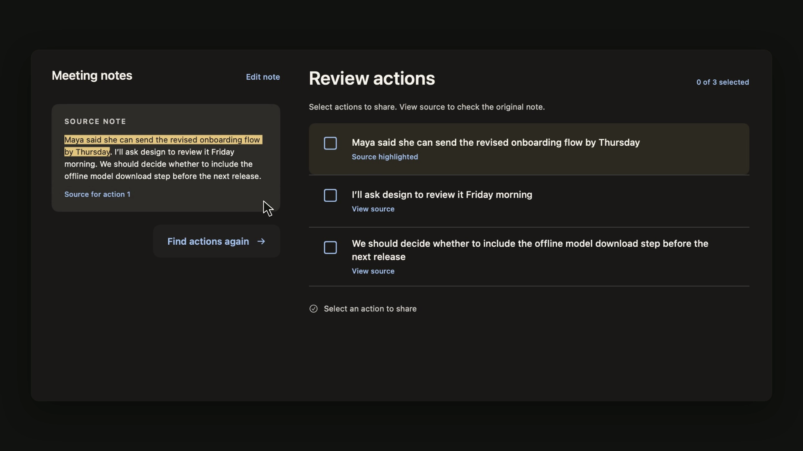

# Fieldnotes

A SwiftUI sample that finds possible action items in meeting notes and lets you check each one against the original text before sharing it.

[](media/demo.mp4)

[Watch the 21-second demo](media/demo.mp4) · [Read the technical write-up](docs/WRITEUP.md) · [Validation and known limits](docs/VALIDATION.md)

The demo was recorded from the app. I edited the cursor movement and shortened the processing wait, so it shows the workflow but not real inference speed.

## What it demonstrates

- RunAnywhere Swift SDK 0.20.24 with llama.cpp
- Qwen2.5 3B Instruct, Q4_K_M (about 1.93 GB)
- Classifies each passage with the full note as context, plus a few English-language rules
- Verbatim source wording, expandable source review and independent action selection
- Local-only SDK initialization and an allowlist for model artifact downloads

The model suggests possible actions. Check each one before sharing: it can miss a task or mistake a sentence for a commitment. The added language rules cover only some English phrasing.

## Run on macOS

Requires macOS 14.5+, an Xcode toolchain with Swift 6.2+, and an Apple Silicon Mac for the tested local model path. From this directory:

```sh
swift build --build-system native
./scripts/package-mac.sh
open dist/Fieldnotes.app
```

The RunAnywhere SDK source is included in this repo. The first build downloads its dependencies. The first time you choose **Find actions**, the app downloads the 1.93 GB model (with extra space needed while downloading). Keep the Mac online for setup. Once cached, the model runs locally.

## Run on iPhone

Requires iOS 17.5+ and Xcode. Open `Fieldnotes.xcodeproj`, choose the `Fieldnotes` scheme and a connected iPhone, set your Apple development team under **Signing & Capabilities**, then run. Change the bundle identifier if Xcode reports that it is already in use. A network connection is needed for the first model download.

I tested one three-action note on an iPhone 15 Pro Max. It took 3.61 seconds after the model loaded; llama.cpp reported all 37 layers running on Metal. That timing comes from a single run. I haven’t tested this build in Airplane Mode or under sustained load. It doesn’t use or measure Apple’s Neural Engine or Qualcomm’s NPU. [Sanitized device log](docs/evidence/iphone-smoke.txt).

## Checks and evaluation

Run the focused parser/language, evidence, and network-policy checks from the project root:

```sh
sh scripts/check-selection.sh
sh scripts/check-evidence.sh
sh scripts/check-network.sh
```

The recorded 5 November run passed all 44 checks. The hybrid pipeline matched expected source passages in 31 of 32 synthetic examples. It missed an implied procurement follow-up. I used the first 24 examples while building the pipeline, so this score measures how the code handles those examples. See [the evaluation notes](docs/EVALUATION.md) for the details.

## Privacy and downloads

In local-only mode, the SDK patches skip telemetry and device registration. The app still connects to download the model. This repo contains no credentials or model weights. See [SDK compatibility notes](docs/SDK-COMPATIBILITY.md) and [third-party notices](THIRD_PARTY.md).

## License

I haven’t assigned a license to the Fieldnotes app code. The RunAnywhere SDK and its local changes have their own terms in `Vendor/runanywhere-swift/LICENSE`; other dependencies keep their upstream licenses. See [THIRD_PARTY.md](THIRD_PARTY.md). Apache-2.0 does not automatically apply to the app code.
